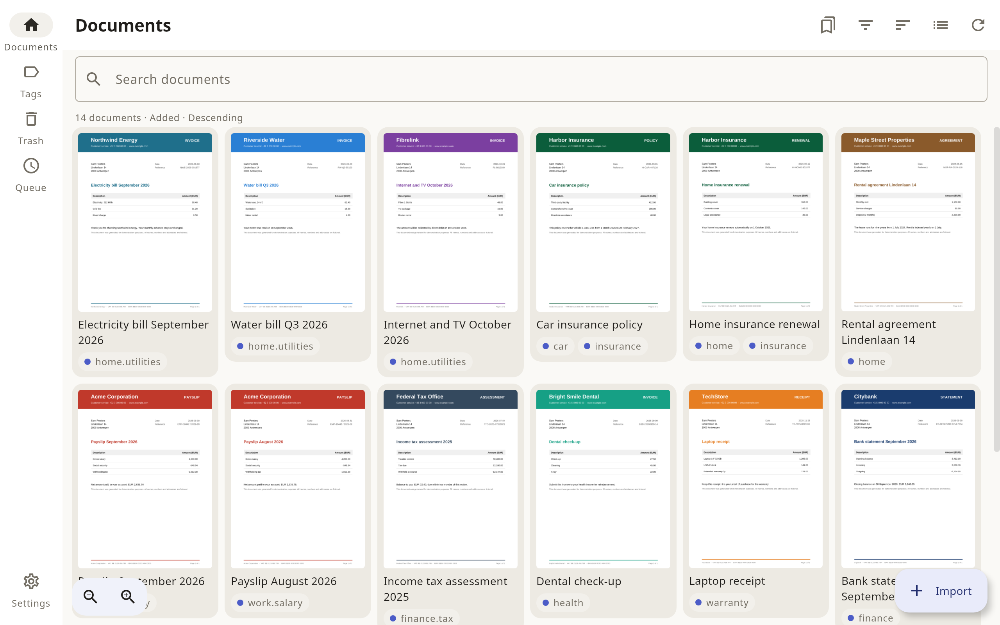
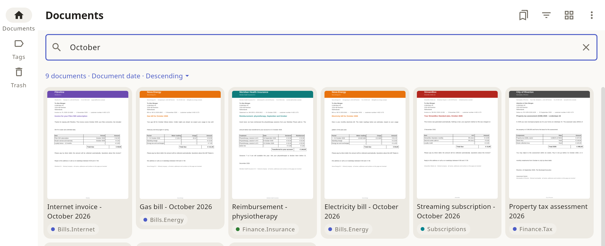
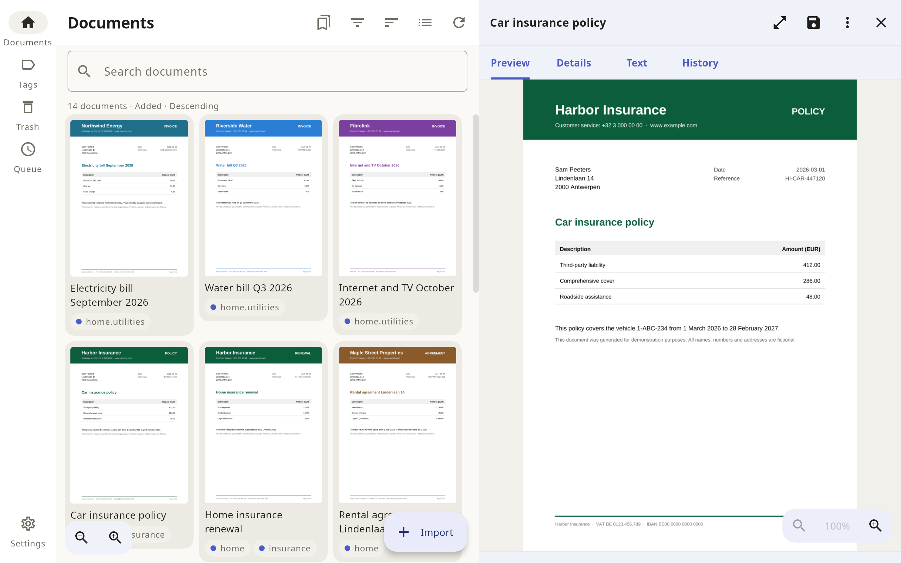
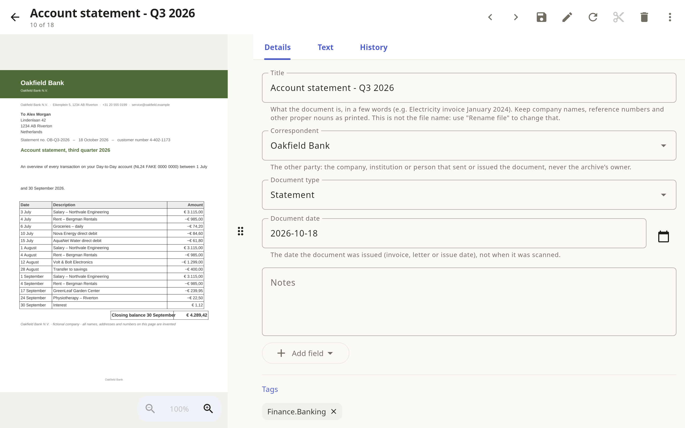
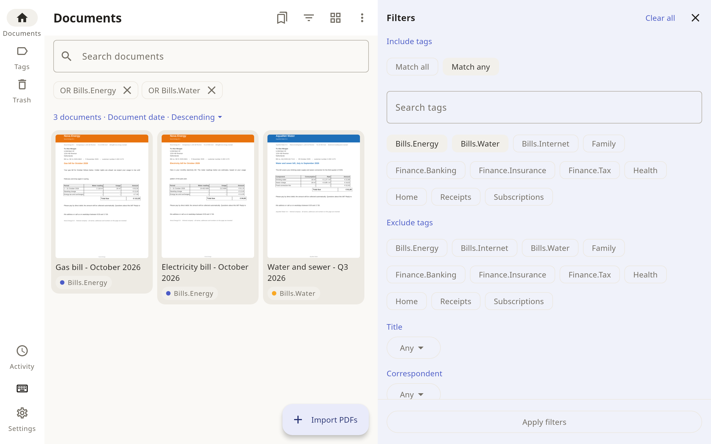
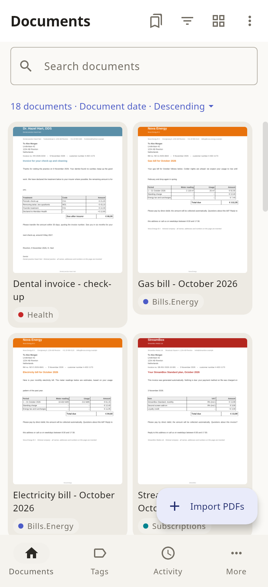
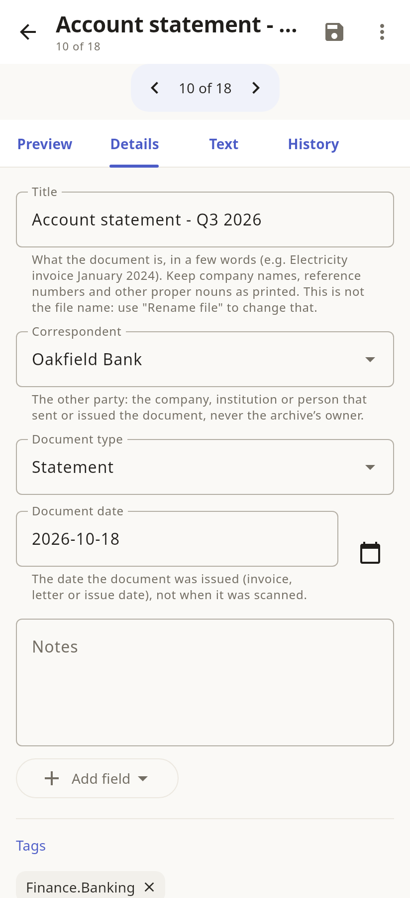
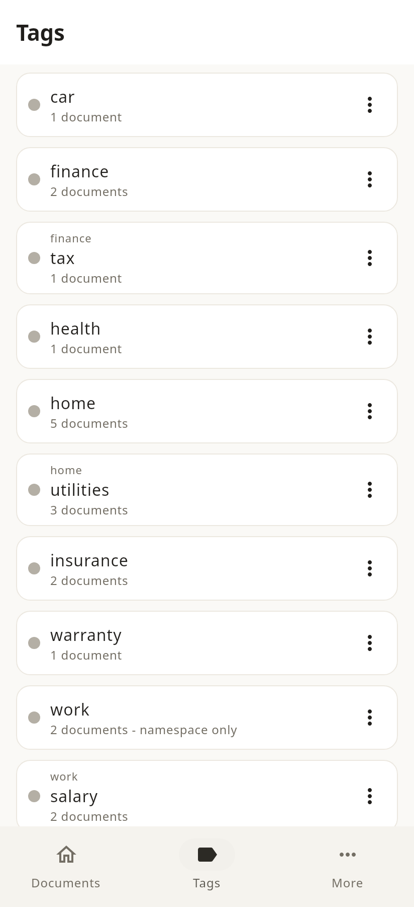

# No papers needed

**Your paperwork, organized. Your files, still yours.**

No papers needed turns the pile of bills, contracts, receipts and letters into a
searchable library on your phone and your computer. Scan a letter, drop in a
download, and find it again in seconds by typing a word from the page.

There's no account to create and no server to run. Your documents stay ordinary PDFs in
a folder you choose, readable by any other app, today and in ten years.

## Why you'll like it

- **Find anything.** Search the full text of every document, scans included. Text
  recognition runs in the background, so a photo of a letter becomes searchable too.
- **Scan in seconds.** On Android, point your camera at a page and the scanner crops
  and straightens it. Share a PDF or photo from any app straight into your library.
- **Drag, drop, done.** On the desktop, drag files into the window or let the app watch
  an inbox folder and pick up whatever lands there.
- **Organize your way.** Tags (nested if you like), correspondents, document types,
  dates, notes, and fields you define yourself. Rules can tag new documents
  automatically based on their text.
- **Stay on top of new arrivals.** A review queue shows what still needs sorting, and
  saved views keep your favorite filters one tap away.
- **Every device, one library.** Keep the folder in sync with the tool you already use,
  such as Syncthing or Nextcloud, and every phone and computer sees the same documents,
  tags and search results. Changes made on two devices at once merge cleanly.
- **Or sync it to your cloud from the app.** Mirror the library to Google Drive, Dropbox,
  OneDrive, WebDAV/Nextcloud, S3, Backblaze B2, SFTP and more, set up entirely in the app:
  pick a provider, sign in and choose a folder. The files stay plain files there too, and
  nothing else needs installing.
- **No lock-in.** Your files are never converted, renamed behind your back or locked in
  a database. Stop using the app and you still have a tidy folder of PDFs.
- **Safe by design.** Deleted documents go to a trash you can restore from, and the app
  spots duplicates and files that went missing.

## A closer look

| | |
|---|---|
|  |  |
| **Search** finds the words inside your documents, not just their names. | **Preview** a document right next to your library. |
|  |  |
| **Details** such as correspondent, type and date, plus fields of your own. | **Filters** narrow the library down by tags, correspondent, type or any field. |

### On your phone

The same library, laid out for a small screen.

  
  
  

## Optional AI assistant

Connect an AI provider of your choice and the assistant can:

- answer questions about your documents,
- suggest tags and fill in titles, correspondents and dates for a batch of documents,
- read handwriting, tables and faint scans that regular text recognition misses.

It's off until you set it up, it asks before anything that sends documents to your
provider, and nothing lands in your library until you've reviewed it.

## Get it

Download the latest version from the
[releases page](https://github.com/jeroenev/NoPapersNeeded/releases):

- **Android** 11 or newer: the `.apk`.
- **Linux**: AppImage, Flatpak, `.deb` or `.rpm`. Everything needed to run it is
  included. For text recognition on the desktop, install `tesseract-ocr` (the Flatpak
  already includes it).

The app tells you when a new version is out.

Available in English and Dutch.

## For developers

Building from source, packaging, releases and the library format are covered in
[DEVELOPMENT.md](DEVELOPMENT.md). The code layout is in [ARCHITECTURE.md](ARCHITECTURE.md).

## License

Apache-2.0. See [LICENSE](LICENSE).
